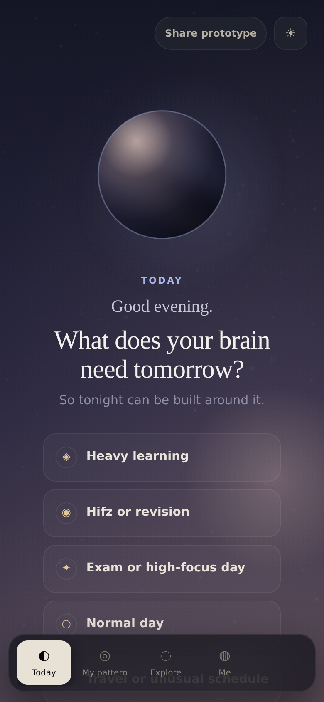
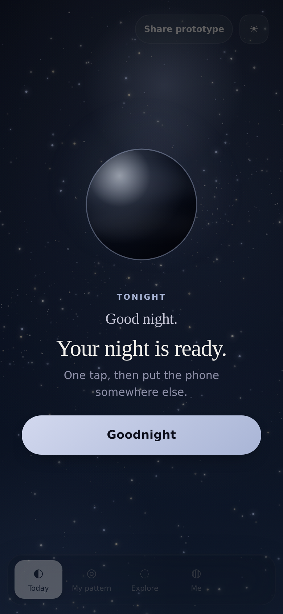
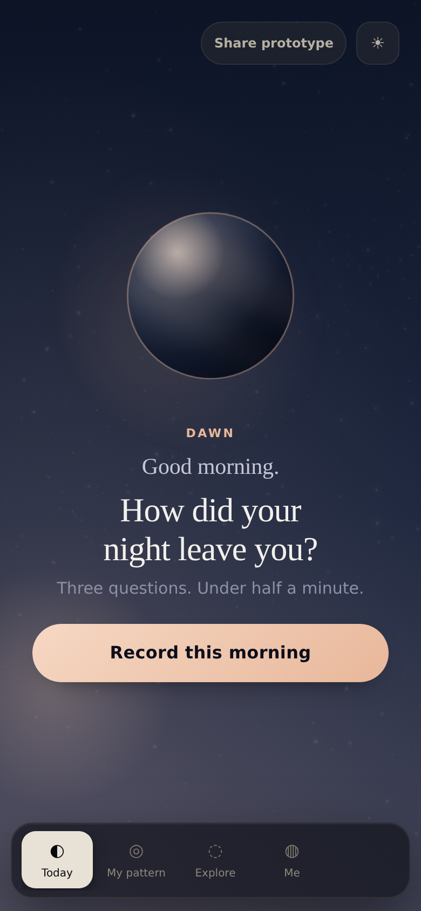
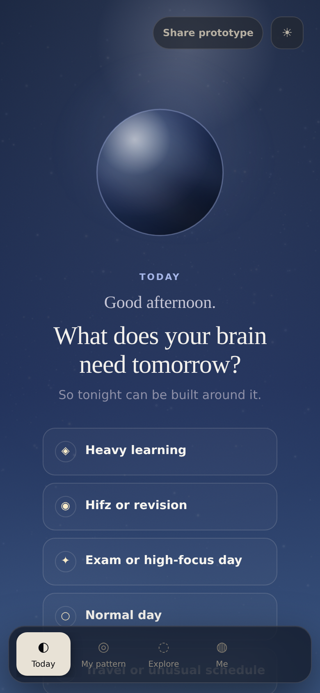
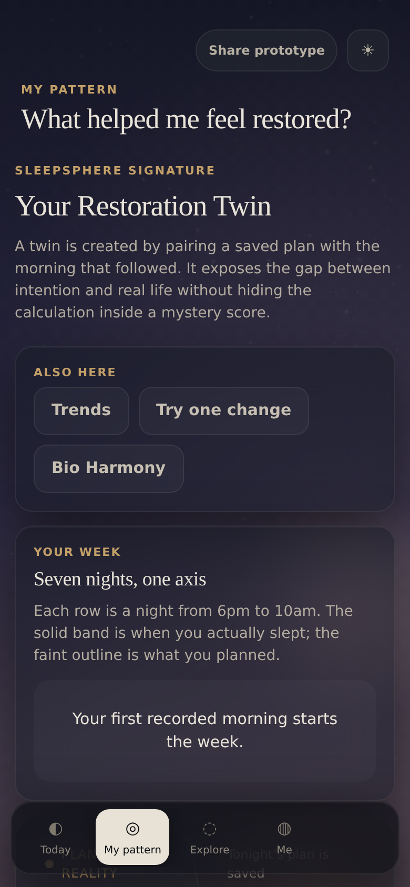
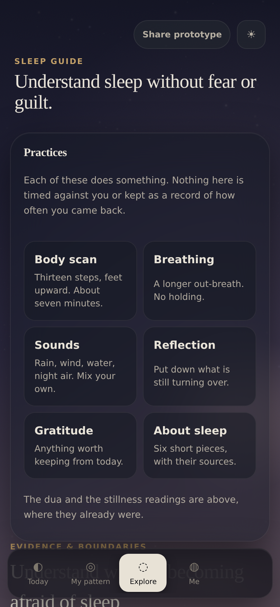
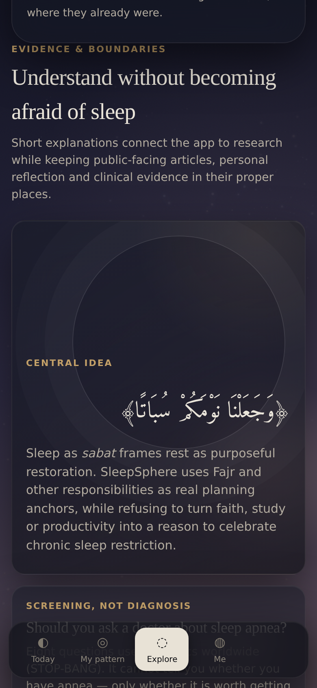
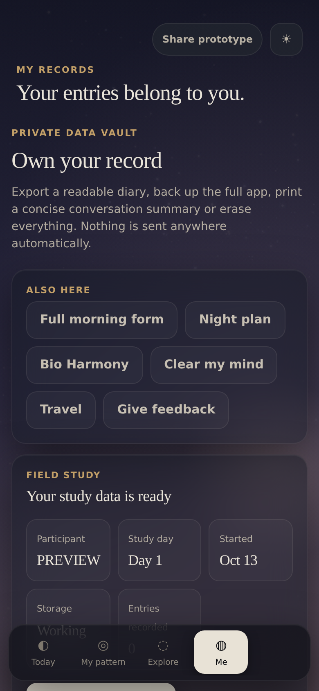
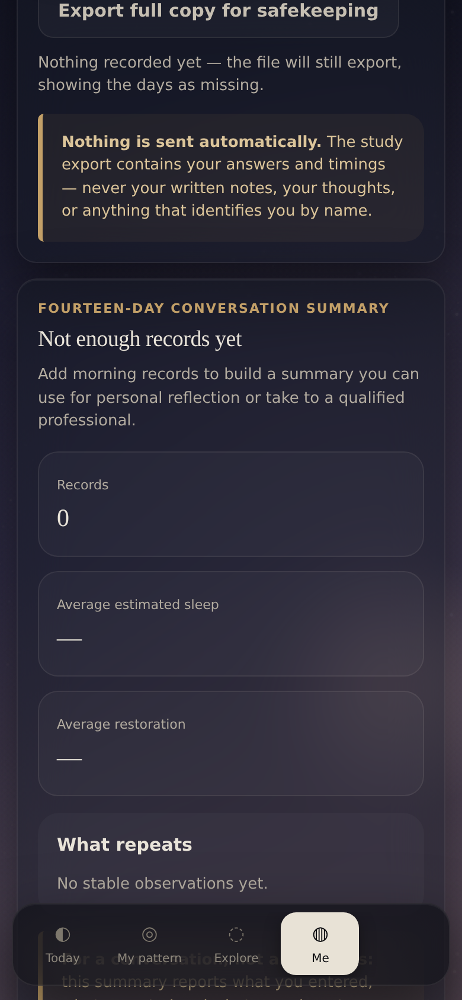

# Feature inventory

Every feature listed here is in commit `2dcabbd` and was exercised by the
automated suite, by a scripted browser pass, or both. Nothing is listed as
working on the strength of the code having been written.

Screenshots were taken at 390 × 844 at 2× — an iPhone-shaped viewport — on
the preview build, with the preview switcher hidden so the pictures show the
product rather than the harness.

---

## The four destinations

The app has exactly four places to be. That number is an invariant: a test
fails if a fifth appears.

| | Destination | What it is for |
|---|---|---|
| ◐ | **Today** | The one screen that changes by time of day |
| ◎ | **My pattern** | What the participant's own records show |
| ◌ | **Explore** | Practices, and the reasoning behind them |
| ◍ | **Me** | Records, exports, settings, study data |

### Today

Today is the whole guided loop: *check today → plan tonight → record
tomorrow*. It rewrites itself across six dayparts (`dawn`, `morning`, `day`,
`evening`, `dusk`, `night`) so the screen asks for the thing that is
actually due.

At night it reduces to one action and an instruction to put the phone down.
This is deliberate and is a stated rule of the project: the app is not
allowed to reward a participant for staying on screen.

 

### My pattern

Trends across recorded nights, including the **Sabat Compass**. Every figure
is computed from records the participant actually entered. Where a night's
sleep duration cannot be derived, it reads as unknown rather than as a
number — `sleepMinutesOf()` returns `null` and callers must handle it.

### Explore

Seven wind-down practices (`even`, `long`, `slow`, `rain`, `wind`, `stream`,
`night`), each with its reasoning rather than an instruction to comply.

### Me

Records, exports and the study panel. Reachable from here: the full morning
form, the night plan builder, Bio Harmony, "Clear my mind", travel, and
feedback.

---

## Sleep tracking

The engine is reachable at `window.SS.engine` and is the **only** sanctioned
write path for a record. A second interface may call it; it may not
recompute any of it, and it may not write a record by any other route.

| Capability | Where |
|---|---|
| Build a night from a wake anchor | `buildNight`, `fitNight`, `nightEvents` |
| Commit tonight's plan | `commitPlan`, `tonightsPlan` |
| Record a morning | `recordMorning` — the one write path |
| Read records safely | `mornings()`, `trustedMornings()` |
| Derive duration | `sleepMinutesOf()` — returns `null` when unknown |
| Correction history | `recordVerification`, supersession chain |

**Verified in this build:** a morning record written through
`recordMorning` moved the store from 0 to 1 record and produced a derived
duration of 390 minutes from the entered times. No value was invented.

Three properties the integrity layer holds, described fully in
[`HANDOVER.md`](../HANDOVER.md):

- **Flags are derived, never stored**, so a record already on disk is
  recognised without editing the evidence.
- **Corrections supersede rather than overwrite.** The superseded version
  leaves `state.mornings` entirely and lives in `state.morningRevisions`,
  so no read site can accidentally count both.
- **`unverified` is not `untrusted`.** Ordinary one-tap nights still count;
  excluding them would erase a participant's history to fix one night.

---

## Motherhood

Pregnancy and postpartum records, behind a boundary built before any
sensitive field existed. The rules are in [`MOTHERHOOD.md`](../MOTHERHOOD.md)
as B1–B6.

| Property | Status |
|---|---|
| Separate from ordinary research export by default | **enforced and tested** |
| Encrypted at rest (AES-GCM, PBKDF2-SHA-256, 250 000 iterations) | implemented |
| Never transmitted silently | no network path exists at all |
| Avoids diagnosis or medical promise | copy reviewed |

**Verified in this build:** an entry written through `window.__motherhood`
round-tripped, and `__motherhood.exported()` — which is exactly what a
written export file would contain — did **not** contain it.

---

## Faith features

| Feature | Note |
|---|---|
| Fatimi prayer times | Fajr 17.7°, Asr shadow factor 1, Maghrib at sunset, Isha 14° |
| Nisf al-layl window | halfway from sunset to **sunrise**, for one twelfth of the night |
| Ihtiyat | end times shown ~2 minutes early; start times rounded |
| Sihori / Fajr handling | planned around, not merely displayed |
| Duʿāʾ | `test/dua.js` |

These were wrong until a real Dubai Dawat timetable caught them; the
corrections and the two independent references they are checked against are
documented in [`test/README.md`](../test/README.md).

---

## Other capability

| Feature | Evidence |
|---|---|
| Apnea screening | `test/apnea-screening.js`, 16 checks |
| Bio Harmony check-ins | in `Me` |
| "Clear my mind" thought unloading | `SS.engine.addThought` |
| Travel / timezone handling | `test/context.js` |
| Lazy mode (one-tap nights) | `test/lazy-mode.js`, 26 checks |
| Feedback capture | `test/feedback.js` |
| Field study enrolment and export | `test/fieldwork.js`, 153 checks |
| Offline use | service worker, `sleepsphere-v12-livingsky-20261013` |
| Worlds (alternate interfaces) | `plain` and `flight` registered |
| Living Sky footage layer | **off by default** — see limitations |

---

## Deliberately absent

Listed so that absence reads as a decision rather than an oversight.

- **No streaks, no points, no badges.** Rewarding return visits at bedtime
  would work against the product's purpose.
- **No account, no login, no server.** There is nothing to breach.
- **No fabricated measurement.** Where a value is unknown the app says so.
- **No placeholder media.** A daypart either has a real licensed recording
  or it reports `unavailable`.
